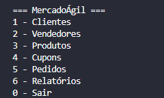
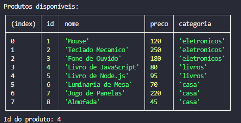
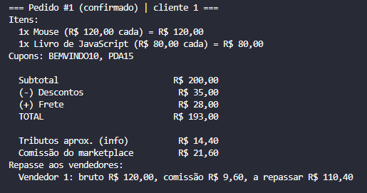
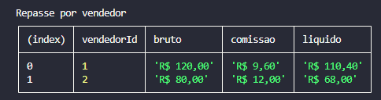

# 🛒 MercadoÁgil: Microsserviço de Pedidos


Serviço de pedidos de um marketplace, feito em JavaScript puro com Node.js e executado no terminal. Projeto final do Módulo 1 do Programadores do Amanhã, desenvolvido pelo **SQUAD**.

O MercadoÁgil registrava pedidos numa planilha e tinha sempre os mesmos problemas: cupom aplicado errado, pedido confirmado sem estoque, frete calculado "no olho", repasse errado para o vendedor, ninguém sabia quanto faturou e o CPF do cliente aparecia em qualquer tela. Este serviço resolve cada um deles com regras testadas.

## Como rodar

Requisito: Node.js 18 ou mais novo.

```bash
git clone [https://github.com/BrunaStefany/mercadoagil](https://github.com/BrunaStefany/mercadoagil)
cd mercadoagil
npm install
npm start

```

Ao abrir, o sistema carrega os dados de exemplo (`src/data/seed.js`) e mostra o menu principal:

```text
1. Clientes   2. Vendedores   3. Produtos   4. Cupons   5. Pedidos   6. Relatórios   0. Sair

```

Para rodar a suíte de testes automatizados (28 testes validando cálculo, estoque e LGPD):

```bash
npm test

```

### Roteiro rápido: o pedido de exemplo

1. `5` (Pedidos), `1` (Criar pedido), ID ou CPF do cliente (ex: Ana Souza, CPF `12345678909`).
2. `2` (Adicionar item): produto `1` (Mouse), quantidade `1`. Repita com o produto `4` (Livro de JavaScript), quantidade `1`.
3. `3` (Aplicar cupom): `BEMVINDO10`. Repita com `PDA15`.
4. `4` (Ver resumo): o total deve ser **R$ 193,00**.
5. `5` (Confirmar pedido), `0` para voltar, `6` (Relatórios), `1` (Exibir relatório completo).

## Regras de negócio

### Estoque: tudo ou nada

* Ao confirmar, o pedido confere **todos os itens de uma vez** no estoque.
* Se faltar qualquer item, nada é confirmado e nada sai do estoque. A mensagem lista **todos** os itens em falta.
* Pedido confirmado dá baixa no estoque. Pedido confirmado e depois cancelado devolve os itens.
* O pedido só aceita mudanças (itens e cupons) enquanto estiver `aberto`. Os status são `aberto`, `confirmado` e `cancelado`.

### Cupons

| Tipo | O que faz | Exemplo |
| --- | --- | --- |
| `percentual` | tira uma porcentagem | `BEMVINDO10`: 10% |
| `fixo` | tira um valor em reais | `PDA15`: R$ 15,00 |
| `frete` | zera o frete | `FRETEZERO` |

1. Cupom vencido é recusado, mesmo que estivesse válido quando foi cadastrado (também é conferido de novo ao confirmar).
2. O subtotal precisa atingir o valor mínimo do cupom.
3. No máximo 2 cupons por pedido, e o mesmo cupom não entra duas vezes.
4. Cupom não cumulativo só pode ser usado sozinho.
5. O desconto total nunca passa de 30% do subtotal, e o total nunca fica negativo.

### Ordem de aplicação dos descontos

1. **Percentuais primeiro.** Se houver dois, o segundo incide sobre o que sobrou depois do primeiro.
2. **Fixos depois**, somados e limitados ao que ainda resta do subtotal.
3. **Frete por último:** o cupom de frete zera o frete e não entra na conta do desconto.
4. **Teto:** a soma de percentuais e fixos é cortada em 30% do subtotal.

### Frete

`taxa da região + R$ 1,50 por unidade`, um só por pedido, mesmo com vendedores diferentes.

| Norte | Nordeste | Centro-Oeste | Sudeste | Sul |
| --- | --- | --- | --- | --- |
| R$ 35,00 | R$ 25,00 | R$ 30,00 | R$ 20,00 | R$ 22,00 |

Frete grátis quando o valor já com descontos chega a **R$ 300,00**, ou quando o pedido usa cupom do tipo `frete`. Pedido vazio não paga frete.

### Tributos, comissão e repasse

Calculados sobre o valor dos itens, **antes dos descontos**. Cupom e frete são custo do marketplace e não diminuem o repasse.

| Categoria | eletronicos | livros | alimentos | vestuario | casa |
| --- | --- | --- | --- | --- | --- |
| Tributos (informativo, não soma no total) | 12% | 0% | 5% | 8% | 10% |
| Comissão do marketplace | 8% | 15% | 10% | 12% | 10% |

Repasse do vendedor = soma dos itens dele menos a comissão desses itens. Só pedidos **confirmados** geram repasse.

### Exemplo completo

Cliente do Nordeste compra 1 Mouse (eletrônicos, R$ 120,00) e 1 Livro de JavaScript (livros, R$ 80,00), com `BEMVINDO10` e `PDA15`:

```text
Subtotal                              R$ 200,00
(-) BEMVINDO10: 10% de R$ 200,00    - R$  20,00
(-) PDA15: desconto fixo            - R$  15,00
(+) Frete: R$ 25,00 + 2 x R$ 1,50   + R$  28,00
TOTAL                                 R$ 193,00

Desconto total: R$ 35,00 (dentro do teto de 30% = R$ 60,00)
Tributos aproximados: 12% x 120,00 + 0% x 80,00 = R$ 14,40

Repasse:
Vendedor 1    R$ 120,00 - comissão 8% (R$ 9,60)   = R$ 110,40
Vendedor 2    R$  80,00 - comissão 15% (R$ 12,00) = R$  68,00
Comissão total do marketplace: R$ 21,60

```

### Relatórios

Consideram **somente pedidos confirmados**: faturamento total, quantidade de pedidos, ticket médio, total de descontos, tributos e comissões, faturamento por categoria (valor dos itens antes dos descontos), repasse por vendedor (bruto, comissão e valor a repassar) e top 3 produtos mais vendidos.

## Estrutura de pastas

```text
.
├── index.js                  # ponto de entrada: abre o menu
├── package.json              # "type": "module"
├── src/
│   ├── cli/                  # menus e interação com o usuário
│   ├── config/               # regras de negócio centralizadas
│   ├── data/                 # seed.js e seedCupons.js
│   ├── models/               # Cliente, Vendedor, Produto, CupomDesconto, Estoque, Pedido
│   ├── schemas/              # validações estruturadas com Zod
│   ├── services/             # Marketplace.js e relatorios.js
│   └── tests/                # testes automatizados com npm test
└── docs/
    └── img/                  # prints e recursos visuais do projeto

```

## Decisões do squad

* **O menu só lê e mostra.** Quem decide é o `Marketplace` e as classes. As regras de negócio não se espalham pelas telas.
* **Toda resposta padronizada.** Nenhum dado inválido ou erro inesperado derruba o programa. As mensagens são amigáveis e em português.
* **Encapsulamento e Transacionalidade.** Estoque e status do pedido só mudam por métodos seguros (`confirmar()`, `cancelar()`), garantindo a regra "tudo ou nada".
* **Privacidade e LGPD.** O CPF é validado estritamente no cadastro, mas é omitido (`undefined`) em listagens e buscas públicas.
* **Testes Automatizados.** Suíte robusta construída com o executor nativo do Node.js (`node:test`), cobrindo cálculos, integridade de estoque e proteção de dados.

## Quem fez o quê

| Integrante | Responsabilidades |
| --- | --- |
| **Johnson** | Classe Cliente, schemas de validação e suporte à orquestração de buscas. |
| **Marlon Neves** | Classe Vendedor, schemas e agregação de dados financeiros. |
| **Matheus Gregorio** | Classe Produto, schemas e centralização de regras matemáticas. |
| **Alef Barros** | Classes Estoque e Pedido, garantindo a integridade transacional. |
| **Laissa Vitória** | Classe CupomDesconto, schemas e aplicação de limites e tetos de desconto. |
| **Bruna Stefany** | `seed.js`, relatórios financeiros, testes automatizados, correções de integração e documentação. |

## Prints do Terminal

**Menu Principal:**



**Produtos Disponíveis:**



**Resumo do Pedido (Exemplo de R$ 193,00):**



**Relatório de Repasse por Vendedor:**



## Links

* Repositório: https://github.com/BrunaStefany/mercadoagil
* Post no LinkedIn: [Link do Post]

## Licença

MIT. Veja o arquivo `LICENSE`.